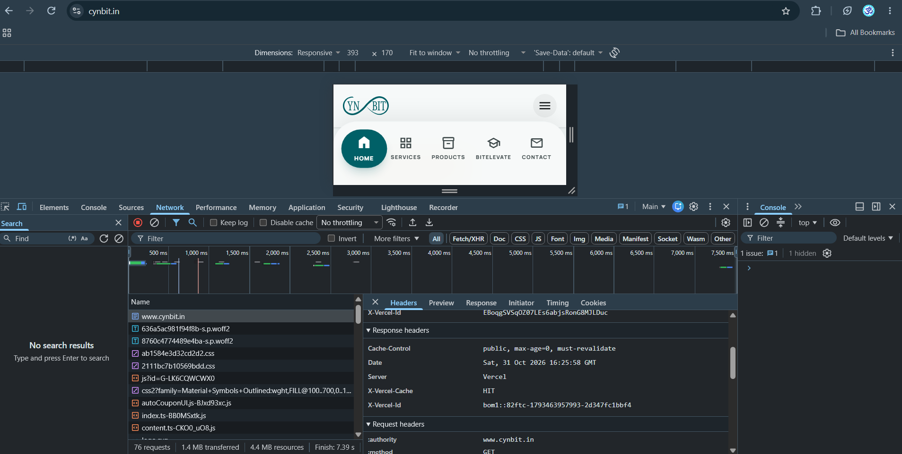
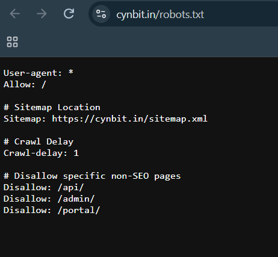
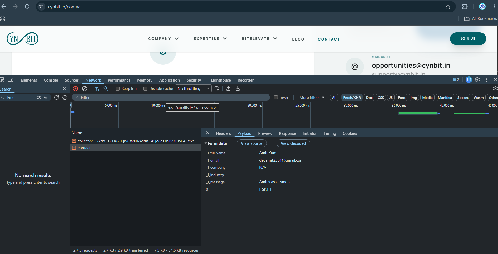
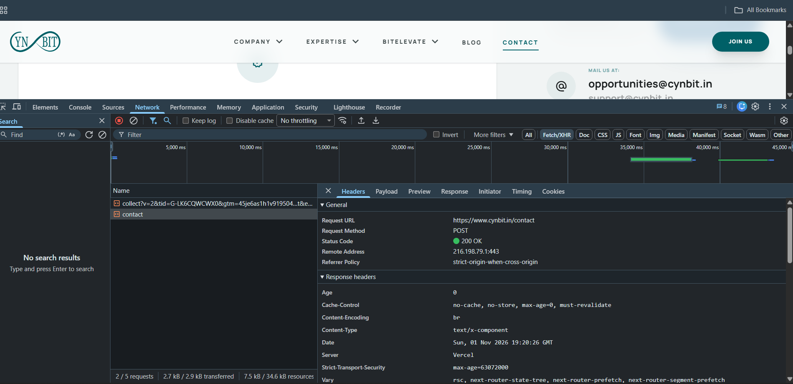
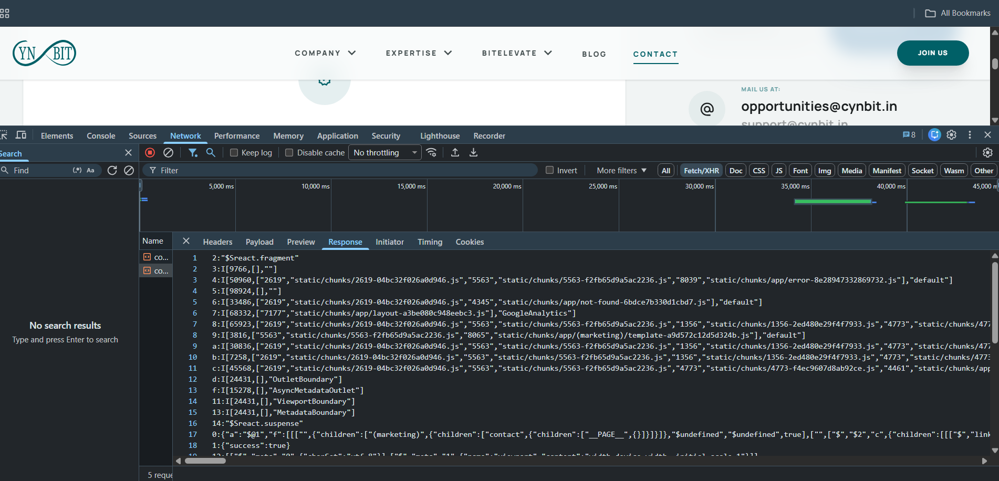
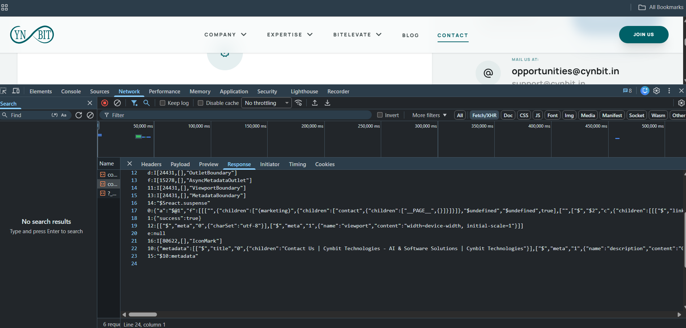

# 4. DevTools Evidence (passive observations)

Only observations made by browsing the public site normally. Anything not captured is listed under Limitations (section 4.5).

## 4.1 Homepage document response (`https://www.cynbit.in/`, Network tab, Headers)

| Header / field | Value seen | Note |
|---|---|---|
| `Cache-Control` | `public, max-age=0, must-revalidate` | Browser revalidates every time; edge may still cache |
| `Server` | `Vercel` | Hosting platform |
| `X-Vercel-Cache` | `HIT` | HTML served from Vercel's edge cache |
| `X-Vercel-Id` | `bom1::...` | Request served via the `bom1` region prefix |
| `Date` | `Sat, 31 Oct 2026 16:25:58 GMT` | |
| `:authority`, `:method` pseudo-headers | present | Request used HTTP/2 or later |
| `Strict-Transport-Security` | not listed in this capture | present on the contact response, see 4.4 |
| `Content-Security-Policy` | not listed | see F9 |
| `X-Frame-Options` | not listed | see F9 |
| `X-Content-Type-Options` | not listed | see F9 |
| `Referrer-Policy`, `Permissions-Policy` | not listed | see F9 |
| `Content-Type`, `Content-Encoding` | not listed in the capture | Suggests a cached revalidation (304) or a partial capture; re-capture with **Disable cache** ticked and include the General section (status code) |

## 4.2 Page load capture

Captured in Chrome responsive device mode (393 px wide), no throttling.

| Metric | Value | Reliability |
|---|---|---|
| Requests | 76 | Inflated: includes browser-extension scripts |
| Transferred / resources | 1.4 MB / 4.4 MB | Inflated, same reason |
| Finish | 7.39 s | Includes late third-party requests |

Requests such as `autoCouponUI.js`, `index.ts-*.js` and `content.ts-*.js` look like browser-extension scripts, not Cynbit assets, and are excluded from findings. Re-capture in an Incognito window with extensions disabled before quoting numbers.

Third-party requests seen: a Google Analytics tag (`gtag/js`) and a Google Fonts stylesheet for **Material Symbols Outlined** requesting the variable axes `wght,FILL@100..700,0..1`. Font file sizes were not visible in the capture.

Font files named `...-s.p.woff2` follow the `next/font` self-hosting pattern, consistent with Next.js.

## 4.3 Public files

| Item | Result |
|---|---|
| `/robots.txt` | Disallows `/api/`, `/admin/`, `/portal/`; crawl-delay 1; sitemap at `https://cynbit.in/sitemap.xml` |
| `/sitemap.xml` | Static pages share one request-time `lastmod`; blog/careers/diaries entries 1-3 ms apart |

## 4.4 Contact form submission (one submission, test data)

| Field | Value seen | Note |
|---|---|---|
| Request URL / method | `POST https://www.cynbit.in/contact` | Same URL as the page, not an `/api/` route |
| Status | `200 OK` | |
| Request body | form data: `_1_fullName`, `_1_email`, `_1_company`, `_1_industry`, `_1_message`, `0 = ["$K1"]` | Next.js **Server Action** multipart format |
| `Content-Type` (response) | `text/x-component` | React Server Components payload |
| `Cache-Control` | `no-cache, no-store, max-age=0, must-revalidate` | Correct for a form submission |
| `Content-Encoding` | `br` | Brotli compression |
| `Strict-Transport-Security` | `max-age=63072000` | HSTS present; `includeSubDomains` and `preload` not shown |
| `Vary` | `rsc, next-router-state-tree, next-router-prefetch, next-router-segment-prefetch` | Next.js App Router |
| `Server`, `Age` | `Vercel`, `0` | |

DevTools lists response headers alphabetically. In this capture there is no `Content-Security-Policy` between `Content-Encoding` and `Content-Type`, and no `Permissions-Policy` or `Referrer-Policy` between `Date` and `Server`. `X-Content-Type-Options` and `X-Frame-Options` would be listed below `Vary`, which was cut off, so they were not captured (see 4.5).

### Response body (Response tab)

| Observation | Detail |
|---|---|
| Action result | Line `1:{"success":true}`: the action returns only a boolean on success (no ID, no message) |
| Re-rendered route tree | The response also carries the refreshed page tree (`(marketing)` route group, `contact`, `__PAGE__`) and lists build chunk paths (`static/chunks/...`, `app/error-*.js`, `app/not-found-*.js`, `(marketing)/template-*.js`) |
| Components named | `GoogleAnalytics`, `OutletBoundary`, `ViewportBoundary`, `MetadataBoundary` |
| Metadata | Page title "Contact Us \| Cynbit Technologies - AI & Software Solutions" |
| Size | Small: the Network bar showed about 2.7 kB transferred for the captured requests |

Only a successful submission was made. The failure and validation response format was not tested.

## 4.5 Limitations (not captured)

- `X-Content-Type-Options` and `X-Frame-Options` sit below the visible part of the contact response headers, so they are not rated.
- Only a valid submission was made, so the error and validation response format is unverified. No invalid-input, rate-limit or abuse testing was done, by design.
- The newsletter, studio demo and job application forms were not submitted.
- Cookies, Lighthouse scores and clean (Incognito, extensions off) page-load numbers were not captured. Load figures in 4.2 may include browser-extension traffic.
- Response headers were captured for the homepage and `/contact` only.
